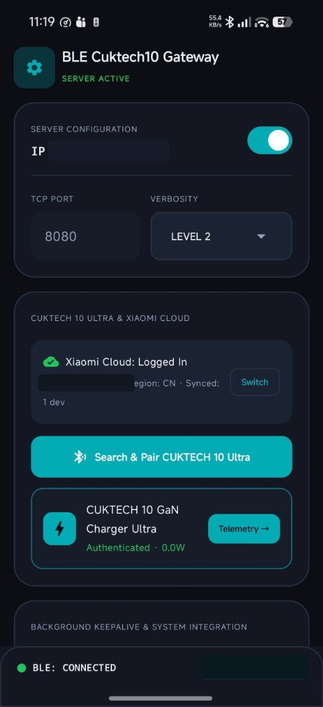
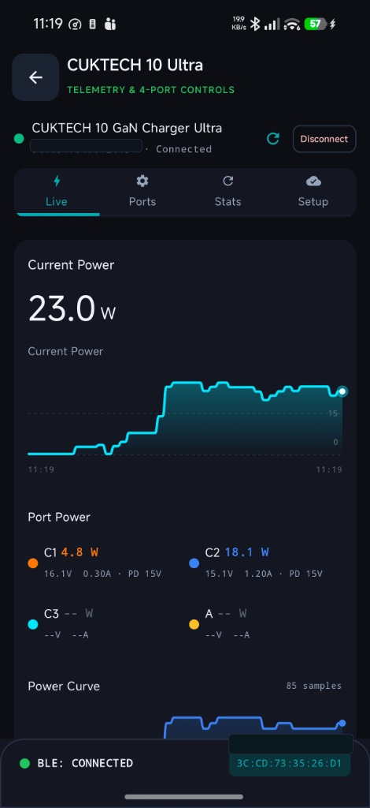
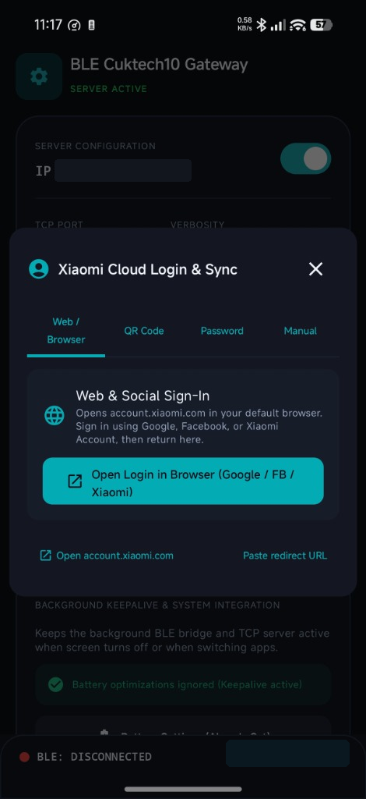
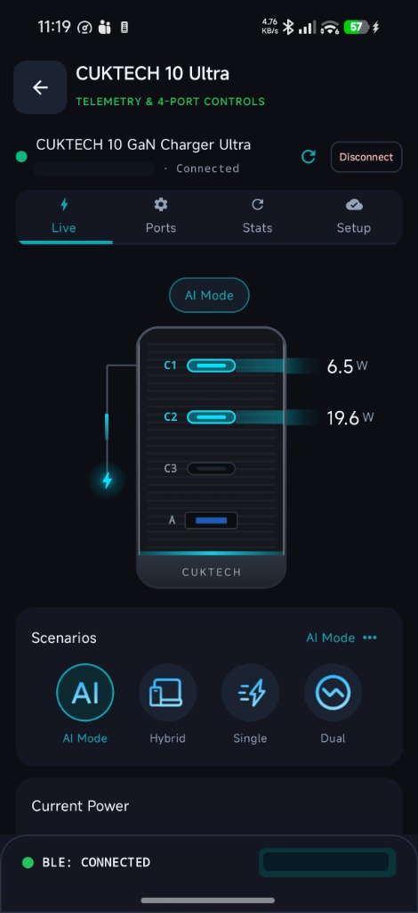
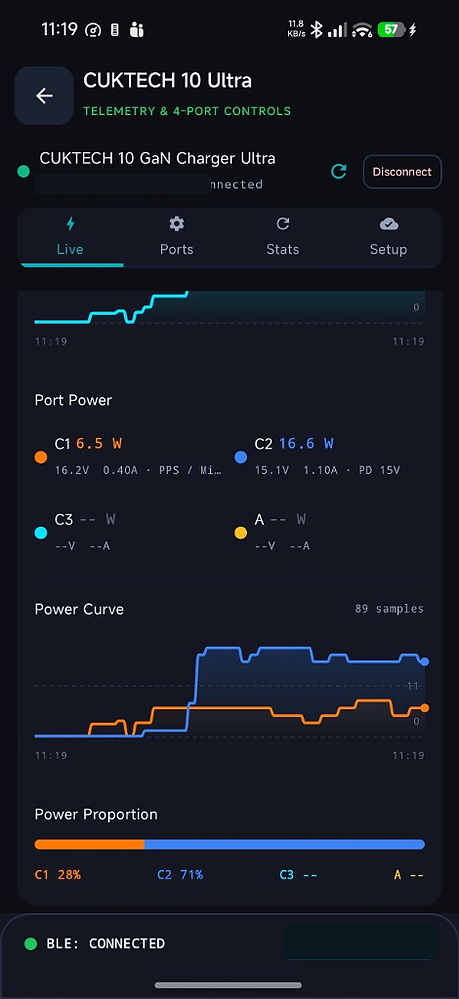
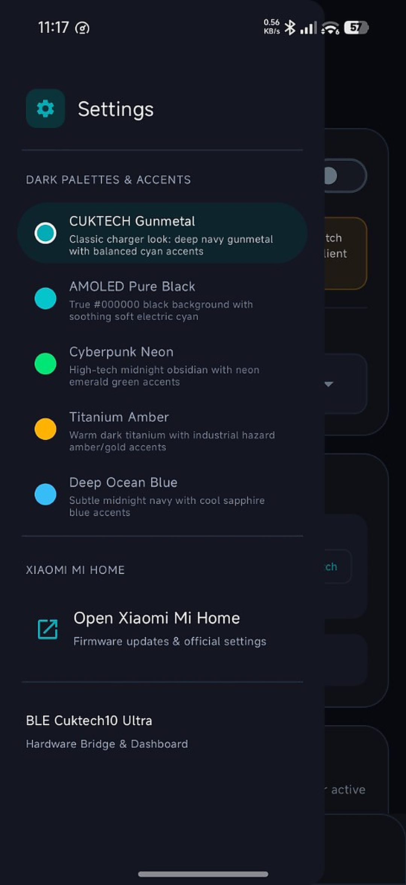
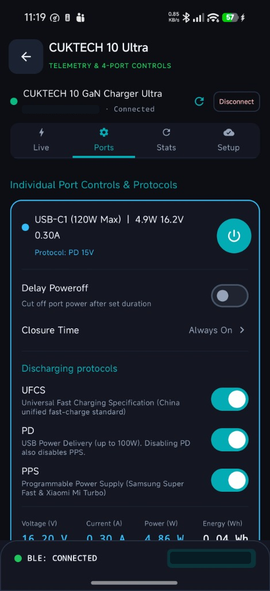
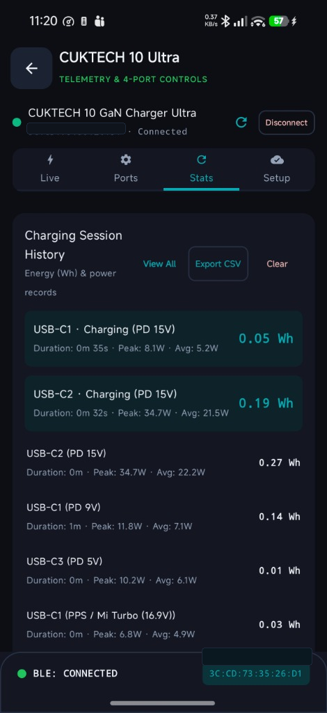
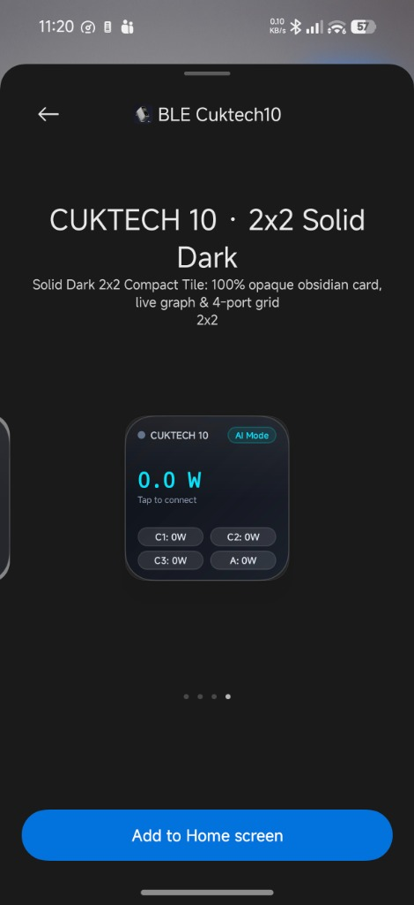
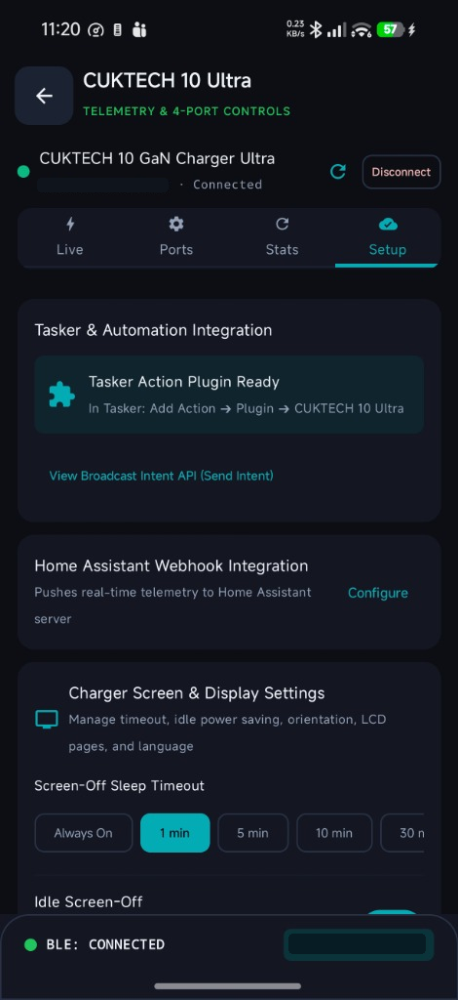

# ⚡ BLEBridge — CUKTECH 10 Ultra GaN Charger (`AD1204`)

<p align="center">
  <b>Native Android BLE Controller, Live Telemetry Dashboard, Automation Hub &amp; TCP Gateway for the CUKTECH 10 Ultra 120W GaN Charger</b>
</p>

<p align="center">
  <a href="../../releases"></a>
  <a href="https://github.com/ImranR98/Obtainium"></a>
  
  
  
  
</p>

> [!NOTE]
> **✨ Vibe-Coded Disclaimer:** This entire native Android application was **vibe-coded** with AI pair-programming by combining and porting two awesome open-source repositories into a unified Kotlin + Jetpack Compose Android app. While it is tested daily on real **CUKTECH 10 Ultra (`AD1204`)** hardware, please review the code and use at your own discretion!

---

## 📖 Quick Links
- **[Full Features & Hardware Documentation (FEATURES.md)](FEATURES.md)** — Complete deep-dive into every single feature, register, dialog, graph, and automation intent.
- **[Releases & APK Downloads](../../releases)** — Pre-built signed APKs for Android 8.0+.
- **[Add to Obtainium](https://api.obtainium.imranr.dev/redirect?r=obtainium://add/https://github.com/cramqin/BLEBridge-Cuktech10-Ultra)** — 1-tap install and automatic background updates via Obtainium.
- **[OEM Background Optimization Guide](https://dontkillmyapp.com/)** — Fix aggressive battery killers on Xiaomi HyperOS, Samsung, etc.

---

## 📱 App Screenshots

| Core Telemetry & Controls | Analytics & Automation | Account & Widgets |
| :---: | :---: | :---: |
| [](docs/screenshots/screenshot_01_gateway_connected.png)<br><sub><b>Gateway & Keepalive</b></sub> | [](docs/screenshots/screenshot_04_telemetry_graph.png)<br><sub><b>Real-Time Rolling Power Curves</b></sub> | [](docs/screenshots/screenshot_02_login_modal.png)<br><sub><b>4 Cloud Login Modes & 2FA</b></sub> |
| [](docs/screenshots/screenshot_03_telemetry_live.png)<br><sub><b>Hardware Port Deep-Linking</b></sub> | [](docs/screenshots/screenshot_06_power_distribution.png)<br><sub><b>Power Proportion Breakdown</b></sub> | [](docs/screenshots/screenshot_05_themes.png)<br><sub><b>5 Dark Accent Palettes</b></sub> |
| [](docs/screenshots/screenshot_07_port_protocols.png)<br><sub><b>Port Protocols & Countdown Timers</b></sub> | [](docs/screenshots/screenshot_08_charging_stats.png)<br><sub><b>Session History & Wh Logs</b></sub> | [](docs/screenshots/screenshot_10_widget_preview.png)<br><sub><b>2x2 Solid Dark Widget Tile</b></sub> |
| | [](docs/screenshots/screenshot_09_automation_setup.png)<br><sub><b>Tasker & Screen Hardware Control</b></sub> | |

---

## 🙏 Acknowledgments & Heritage

This project brings full native Android control for the **CUKTECH 10 Ultra 120W GaN Charger (`njcuk.fitting.ad1204`, Product ID `0x660E`)** by combining and porting the work of two open-source repositories:

1. **[`kairui1108/cuktech-ble-server`](https://github.com/kairui1108/cuktech-ble-server)** *(and [`kairui1108/cuktech-ble-ha`](https://github.com/kairui1108/cuktech-ble-ha))* — Complete reverse-engineered Xiaomi MiOT BLE v5 + CUKTECH Extended v2 protocol implementation, 2-phase ECDH (`SECP256R1`) + `HKDF-SHA256` + `AES-CCM` authentication handshake, 8-byte port telemetry decoding, adaptive energy integration (`Wh`), and hardware SIID/PIID register specifications.
2. **[`woldphone/BLEBridge`](https://github.com/woldphone/BLEBridge)** — Resilient Android Foreground Service BLE-to-TCP network bridge architecture, sequential GATT coroutine task queue, automatic MTU 512 negotiation, and GATT cache recovery.

Huge thanks to the authors of both repositories for making this native Android port possible!

---

## ⚡ Performance, Battery & Polling Architecture

Unlike typical smart home bridges that hammer Bluetooth channels or drain your phone battery, BLEBridge was engineered specifically around the AD1204U hardware's exact BLE characteristics:

- **0.0% CPU & Near-Zero Battery Drain on Idle:**
  - When no device is drawing power, the background service uses negligible CPU (`< 0.1%`) and draws virtually no extra battery over an open BLE connection.
  - **Silent Idle Telemetry Filter:** When a poll returns unchanged `0.0V 0.0A (Idle)` values, the app **silently drops redundant state emissions**. It does not re-compose UI components, trigger launcher widget redraws, fire Home Assistant webhooks, or flood the console log.
- **Smart Push + Adaptive Polling (Hardware-Aware):**
  - **USB-C1 & USB-C2:** The charger hardware automatically broadcasts spontaneous BLE push notifications (`b4 = 0x04`) the instant a cable is plugged in or wattage shifts. BLEBridge listens passively for C1/C2—only running a gentle `3s` backup poll when actively charging to catch unplugs, and **0 polls while idle**.
  - **USB-C3 & USB-A:** The charger firmware never broadcasts push notifications on C3/A. BLEBridge polls C3 and USB-A adaptively: every `5s` when all ports are idle (ensuring fast plug-in detection) and ramps up to `3s` whenever any port is active for smooth `Wh` energy integration.
- **Sequential Mutex Hardware Queue:**
  - Prevents Telink BLE controller deadlocks by funneling all GATT writes through a sequential, non-blocking coroutine queue with automatic 1.8s command timeouts.
- **Widget Battery Optimization:**
  - The Android Home Screen Widgets declare `updatePeriodMillis="0"` (zero alarm-based wakeups). They update reactively only when live state actually changes and are automatically paused by Android when your screen is off.

---

## ⚠️ Prerequisites & Xiaomi Mi Home Requirements

Before using **BLEBridge – CUKTECH 10 Ultra**, please note the following hardware and account requirements:

1. **Initial Device Pairing (Mi Home App Required Once):**
   - Your CUKTECH 10 Ultra **must first be added/bound to your Xiaomi account using the official Xiaomi Mi Home (米家) app**.
   - During initial binding, Xiaomi generates the unique **12-byte MiOT BLE Token** required for Phase B encrypted BLE authentication.
2. **Mainland China (`CN`) Region Required:**
   - The CUKTECH 10 Ultra (`njcuk.fitting.ad1204`) is registered under Xiaomi's **Mainland China (`cn`)** cloud server.
   - In the Xiaomi Mi Home app, your region **must be set to Mainland China (中国大陆)** when adding the charger.
3. **Exclusive BLE Connection (One App at a Time):**
   - The charger's Bluetooth controller only accepts **one active GATT connection at a time**. Do not keep the Mi Home app open in the foreground while BLEBridge is connected (and vice versa).
4. **Firmware Updates:**
   - Official OTA firmware updates for the charger must be performed through the **Xiaomi Mi Home** app. BLEBridge includes a 1-tap **"Open in Xiaomi Mi Home"** button that cleanly releases the Bluetooth handle and launches Mi Home for firmware checks.
5. **Background Keepalive & OEM Battery Optimization ([dontkillmyapp.com](https://dontkillmyapp.com/)):**
   - To keep live BLE telemetry, widgets, and background automations running reliably when your screen is off, tap **"Ignore Battery Optimization"** inside the app's **Background Keepalive & System Integration** card.
   - Aggressive Android OEMs (Xiaomi HyperOS / MIUI, Samsung OneUI, OPPO ColorOS, Vivo OriginOS, Huawei, etc.) often kill background services even with standard Android battery whitelist enabled. Tap the **"OEM Background Guide (dontkillmyapp.com)"** button in the app or visit **[https://dontkillmyapp.com/](https://dontkillmyapp.com/)** to configure Autostart and set Battery Saver to *No Restrictions*.
6. **Invisible in Standard Android System Bluetooth Settings (Normal Behavior):**
   - **You will NOT see the CUKTECH 10 Ultra in your phone's standard Android Bluetooth settings menu**, nor can you pair to it from Android's system Bluetooth scanner.
   - This is because the charger broadcasts nameless, encrypted Xiaomi MiOT `0xFE95` BLE service advertisements (`Product ID 0x660E`) rather than classic Bluetooth or standard HID/audio profiles.
   - **BLEBridge's built-in scanner specifically decodes `0xFE95` advertisements** and matches the embedded MAC/Product ID against your synced Xiaomi Cloud credentials—so even though it's invisible in your phone's Bluetooth settings, **it will appear and connect right inside BLEBridge!**

---

## 📊 Comparison: BLEBridge vs. Official Xiaomi Mi Home App

| Feature / Capability | **BLEBridge (This App)** | **Xiaomi Mi Home App** |
| :--- | :---: | :---: |
| **Initial Charger Binding & Cloud Registration** | ❌ *(Requires Mi Home once)* | ✅ **Yes** |
| **Official Charger OTA Firmware Updates** | ❌ *(Hands off to Mi Home)* | ✅ **Yes** |
| **100% Local Offline BLE Control (After Token Sync)** | ✅ **Yes (Zero cloud dependency)** | ⚠️ **Bluetooth (Requires cloud for plugin load/updates)** |
| **Connection & Startup Speed** | ⚡ **Instant (~1.5s native GATT)** | 🐢 Slow (Heavy plugin initialization) |
| **Persistent Background Keepalive & Live Notification** | ✅ **Yes (24/7 foreground service)** | ❌ Disconnects when screen locks |
| **Interactive Home Screen Widgets (`4x2` & `2x2`)** | ✅ **Yes (Soft Glass & Solid Dark)** | ❌ None |
| **Hardware Visual Panel (Interactive Port Jump)** | ✅ **Yes (Tap port graphic → jumps to port settings)** | ⚠️ Non-interactive graphic |
| **Multi-Line Real-Time Power Curves & Rolling Canvas Graph** | ✅ **Yes (Live 60s multi-line graph)** | ⚠️ Cloud hourly chart only |
| **Force Soft Port Reset (USB-PD Contract Re-negotiation)** | ✅ **Yes (App, Tasker, ADB)** | ❌ None |
| **Per-Port Live Telemetry (`V`, `A`, `W`, Fast-Charge Protocol)** | ✅ **Yes (Real-time graphs & cards)** | ✅ Yes |
| **1-Tap Individual Port Power Toggle (`C1`, `C2`, `C3`, `USB-A`)** | ✅ **Yes (App, Widget, Tasker, ADB)** | ✅ Yes |
| **Power Allocation Scenarios (`AI`, `Hybrid`, `Single`, `Dual`)** | ✅ **Yes (Dialog, Widget, Tasker)** | ✅ Yes |
| **Per-Port Fast-Charge Protocol Switches (`PD`, `PPS`, `UFCS`, `SCP`)** | ✅ **Yes (Individual port control)** | ✅ Yes |
| **Port Auto-Off Countdown Timer (`30m` – `10h`) with Live Ticker** | ✅ **Yes (Second-by-second countdown)** | ⚠️ Basic timer only |
| **Per-Port Energy Cutoff Limit (`Wh` Auto-Shutoff: Once / Always)** | ✅ **Yes (Automatic port cutoff)** | ❌ None |
| **Charging Session History, Peak Wattage & `Wh` Energy Integrator** | ✅ **Yes (With CSV export & charts)** | ⚠️ Limited cloud chart |
| **Tasker / Locale / MacroDroid Native Plugin** | ✅ **Yes (Full UI action plugin)** | ❌ None |
| **ADB / Termux Broadcast Intent API** | ✅ **Yes** | ❌ None |
| **Home Assistant HTTP Webhook Push Integration** | ✅ **Yes** | ❌ None |
| **Raw TCP-to-BLE Socket Gateway (`port 8080`)** | ✅ **Yes** | ❌ None |
| **Built-in Console Log with Filtering & Live Copy** | ✅ **Yes (1,000-message rolling buffer)** | ❌ None |
| **Manual Bluetooth Stack & MiOT Handshake Diagnostics** | ✅ **Yes (On-demand stack audit)** | ❌ None |

---

## ✨ Features Overview

👉 **For the complete in-depth guide to every feature, register, and dialog, see [FEATURES.md](FEATURES.md).**

1. **Interactive Charger Faceplate:** Custom dark obsidian representation of the physical charger on the Live tab. Tap any port on the graphic to jump directly to that port on the Ports tab with a glowing highlight.
2. **Real-Time Rolling Power Graphs:** 60-second multi-line Canvas graph (`Total`, `C1`, `C2`, `C3`, `USB-A`) + embedded sparklines on home screen widgets.
3. **Soft Port Reset (`PIID 25`):** Power-cycles DC-DC buck-boost switches (`0x00 -> 0x0F`) to force fresh USB-PD/PPS contract re-negotiation without pulling plugs.
4. **4 Cloud Login Modes + 2FA:** Google/Web OAuth, Mi Home QR scan, direct password login with SMS/Email 2FA, or offline manual token entry. Multi-device charger switcher included.
5. **Full Port & Protocol Control:** Independent toggles for PD (up to 100W), PPS, UFCS, Huawei SCP, and USB-A 4h low-current mode.
6. **Energy Limits & Timers:** Auto-shutoff by energy (`Wh`) or duration (`30m`–`10h`) with live second-by-second countdown badges.
7. **Session History & CSV Export:** Trapezoidal `Wh` energy integration, Session Detail Inspector dialog, Consolidated Sessions Table dialog, and customizable CSV exports saved to `Downloads/cuktech10/history/`.
9. **Persistent Live Notification & Keepalive:** Ongoing Android Foreground Service notification displaying live wattage, active ports, connection status, and quick action controls without opening the app.
10. **4 Home Screen Widgets:** Soft Glass (`4x2` & `2x2`) and Solid Dark (`4x2` & `2x2`) with 1-tap port toggles and charging sparkline.
11. **Automation Hub:** Full Tasker/Locale action plugin, live telemetry broadcast intent (`com.cramqin.blecuktech10.TELEMETRY_UPDATE`), Home Assistant Webhook, and ADB command interface.

---

## 📦 Installation & Building

### Download Pre-built Signed APK
Grab the latest signed `.apk` directly from the [**Releases**](../../releases) page and install it on any Android 8.0+ (`API 26+`) device.

[](https://api.obtainium.imranr.dev/redirect?r=obtainium://add/https://github.com/cramqin/BLEBridge-Cuktech10-Ultra)

*(Tap the button above if you have [Obtainium](https://github.com/ImranR98/Obtainium) installed for seamless 1-tap installation and automatic background updates directly from GitHub releases!)*

### Build from Source
```bash
git clone https://github.com/cramqin/BLEBridge-Cuktech10-Ultra.git
cd BLEBridge-Cuktech10-Ultra
./gradlew assembleDebug
```

---

## 📄 License & Disclaimer

This project is an independent open-source community tool and is **not** affiliated with, endorsed by, or sponsored by CUKTECH or Xiaomi Corporation. Use at your own risk.
